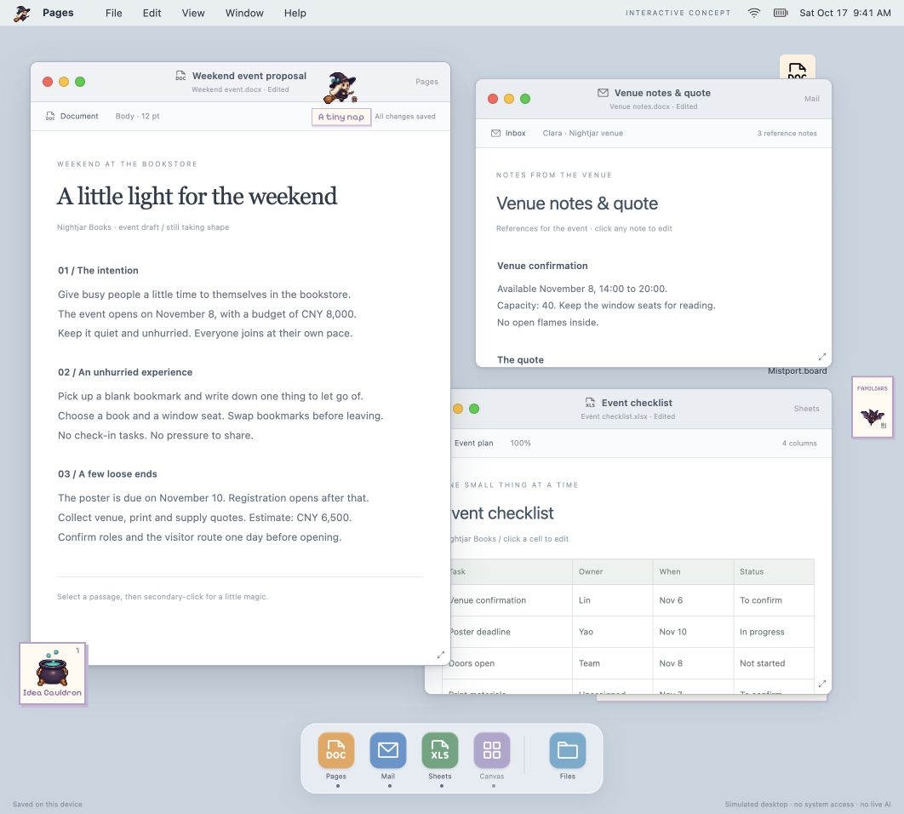
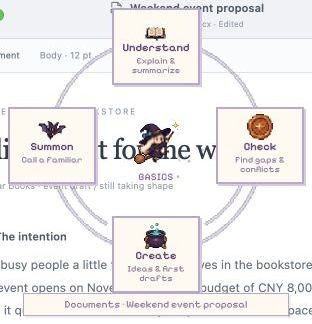
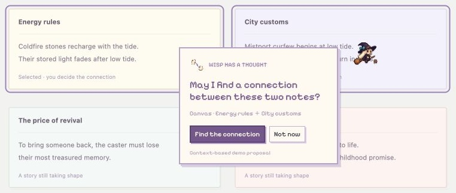

# 小魔女 Wisp · 团队开发指南

当前交付：v0.3.2，英文界面的离线交互原型。



## 本地启动

克隆仓库后，在仓库根目录运行：

```sh
python3 -m http.server 4188 --bind 127.0.0.1
```

打开 http://127.0.0.1:4188/ 。不需要安装 npm 依赖。也可以直接打开 `index.html` 离线体验；浏览器文件权限和存储行为可能不同，团队开发建议使用本地服务器。

## 产品约定

小魔女是一位跟随光标的个人伙伴。用户继续在原来的工具中工作，通过轻量的像素界面调用帮助。当前版本用浏览器模拟常见桌面、文档、表格与白板。

- 四个固定能力：Understand、Check、Create、Summon。
- 找联系、持续关注、记住偏好、跨文档整理等由小魔女主动提出具体 proposal，用户接受后继续。
- 直接召唤使魔无需经过其他能力；默认只处理一次，委托前展示材料范围。
- 熔炉是材料入口，沿用 Understand / Check / Create，并可委托使魔。
- 魔法书承载说明、使魔记录、经确认的偏好和设置。
- 常规桌面与文档使用系统样式；小魔女所有界面使用像素字体与像素视觉。



双指辅助点按或鼠标右键打开菜单；非输入状态也可按 Q。Option + M 打开魔法书，Esc 收起。Canvas 中 Shift 点选两张便笺并停留，可以触发找联系的提议。



完整演示方法见 [中文版图文说明](Wisp-Product-Guide.zh-CN.pdf)。

## 修改与构建

源码都在 `source/`，不要直接修改生成的 `index.html` 或 `source/shell.html`。

```sh
python3 build.py
python3 scripts/check.py
```

构建只依赖 Python 标准库；检查脚本另需 Node.js，用于解析嵌入的 JavaScript。构建会将字体、图片、图标、离线文档读取库和源码内联为两个相同的 HTML 文件，支持离线分发。默认不会写入仓库外的目录。

| 文件 | 职责 |
| --- | --- |
| `source/shell.template` | DOM 结构与初始桌面 |
| `source/style.css` | 桌面和像素魔法层样式 |
| `source/app.js` | 光标伙伴、使魔、授权、记忆与魔法书 |
| `source/abilities.js` | 四项能力、结果与主动提议 |
| `source/desktop.js` | 窗口、文档、表格和白板 |
| `source/os.js` | 菜单栏、工具栏与桌面文件手势 |
| `source/documents.js` | 本地文件文字提取 |
| `assets/` | 像素角色、道具、字体与图标 |
| `vendor/` | JSZip、PDF.js 及许可证 |
| `qa/` | 历史测试素材及界面截图，注意对应版本 |
| `design-qa.md` / `verification.json` | 历史交互验证记录 |

CI 仅检查构建是否可复现与脚本语法；历史 QA 记录不能代替新改动的交互回归。

## 数据与原型边界

这是前端原型，尚未接入真实 AI，也不能读取其他软件或在真实系统桌面覆盖光标。推理、生成、进度与后台任务采用本地规则和计时模拟；关闭页面会暂停模拟任务。

本地文件文字提取、文档编辑和 localStorage 保存是真实交互。文件内容不会上传服务器。当前存储键为 `pixel-witch-companion-en-v3`；不同域名或端口的浏览器存储彼此独立。开发时不要把真实用户资料或 API 密钥写进源码和测试素材。

## 建议的团队协作方式

从 `main` 新建功能分支，修改源码后重新构建，提交源码和生成的 HTML，通过 PR 合并。涉及 UI 的 PR 附截图和复现步骤；涉及 proposal / 使魔的改动，核对授权、材料范围、拒绝、暂停与召回流程。

后续接入方向：原生系统覆盖层与辅助功能权限、真实模型服务、可撤销的任务执行与跨软件上下文。现阶段这些是待开发能力。

## 资源来源

字体、图标与文档读取库分别遵循各自许可证，见 [第三方资源说明](THIRD_PARTY_NOTICES.md)。本仓库未设置开源授权；私有仓库供团队协作使用。
